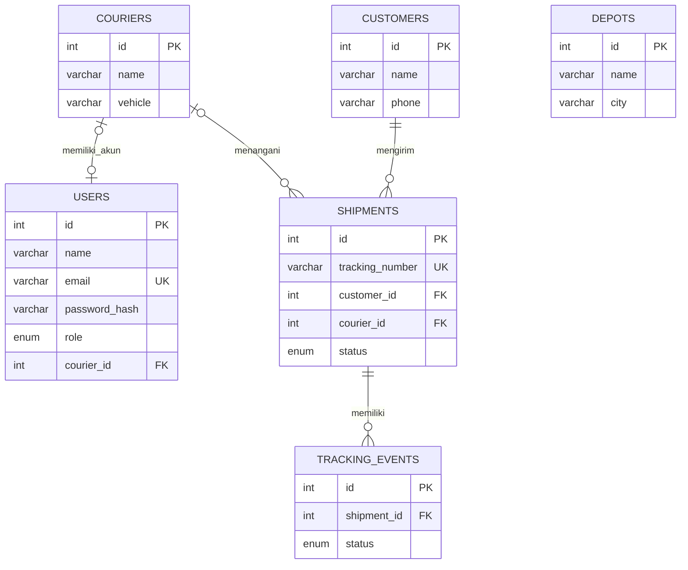

# Dokumentasi Tugas Besar Manajemen Proyek
## KirimKita — Sistem Informasi Manajemen Pengiriman Barang (3 Pengguna)

**Jenis:** Aplikasi logistik berbasis web sederhana.  
**Tujuan:** Mencatat pengiriman, membagi penugasan kurir, memperbarui status paket, dan menyediakan tracking transparan bagi pelanggan.  
**Pendekatan:** Waterfall sederhana; analisis → desain → implementasi → pengujian → demonstrasi.

### A. Latar belakang

Pencatatan dan penyampaian informasi pengiriman secara manual menyulitkan pemantauan paket. KirimKita memusatkan data pengiriman di MySQL dan menyediakan tiga antarmuka yang sesuai tugas masing-masing aktor: admin, kurir, dan pelanggan.

### B. Aktor & persyaratan fungsional

| Kode | Aktor | Kebutuhan | Kriteria penerimaan |
| --- | --- | --- | --- |
| F-01 | Admin, Kurir | Login petugas sesuai role | Kredensial benar masuk dashboard sesuai role; salah ditolak |
| F-02 | Admin | Dashboard operasional | Data statistik dari MySQL |
| F-03 | Admin | CRUD pelanggan dan kurir/armada | Tambah, edit, hapus dengan validasi dan aturan foreign key |
| F-04 | Admin | CRUD pengiriman | Resi unik, dapat menugaskan kurir, membuat riwayat awal |
| F-05 | Admin | Kelola depo dan akun petugas | Tambah, edit/hapus depo; buat/hapus/reset akun admin/kurir |
| F-06 | Admin | Status dan laporan | Update status masuk timeline, filter, ekspor CSV |
| F-07 | Kurir | Dashboard & tugas | Hanya tugas terhubung dengan akun kurir yang muncul |
| F-08 | Kurir | Cari resi dan proses tugas | Hanya paket sendiri; transisi status berurutan dan tersimpan |
| F-09 | Kurir | Riwayat dan profil | Paket selesai dan perubahan akun dapat dilihat/disimpan |
| F-10 | Pelanggan | Lacak resi tanpa login | Input resi → status, tujuan singkat, dan timeline tampil |
| F-11 | Semua | Pembatasan server | URL/POST lintas role ditolak walaupun menu diganti manual |

**Batas proyek:** Tidak ada login/registrasi pelanggan, GPS, payment gateway, integrasi ekspedisi asli, kalkulasi ongkir otomatis, notifikasi WhatsApp, atau pemindaian kamera yang dijamin di semua browser. Halaman scan menyediakan input manual, scanner keyboard, dan opsi kamera jika browser mendukung `BarcodeDetector`; admin dapat mencetak label Code39.

### C. Matriks Hak Akses

| Modul | Admin | Kurir | Publik |
| --- | :---: | :---: | :---: |
| Dashboard global & laporan | ✅ | ❌ | ❌ |
| Pengiriman, pelanggan, depo, akun & kurir (CRUD) | ✅ | ❌ | ❌ |
| Dashboard tugas sendiri | ❌ | ✅ | ❌ |
| Cari dan update tugas sendiri | ❌ | ✅ | ❌ |
| Profil petugas | ✅ | ✅ | ❌ |
| Tracking dengan nomor resi | ✅ | ✅ | ✅ |

**Pelanggan adalah pengguna publik (guest), bukan akun yang memerlukan password.** Dua role yang disimpan di tabel `users` adalah `admin` dan `courier`.

### D. Use Case

1. Admin login → membuat pelanggan dan kurir → membuat akun login kurir → mencatat pengiriman dengan kurir terpilih.
2. Kurir login → dashboard hanya memuat tugas yang ditugaskan kepadanya → memilih langkah status berikutnya → sistem memeriksa `courier_id` dan urutan status sebelum menyimpan.
3. Pelanggan memasukkan resi → aplikasi menampilkan status terakhir dan timeline → data kontak dan alamat lengkap tidak dipublikasikan.
4. Admin melihat pembaruan yang sama melalui detail pengiriman dan laporan.

### E. Desain Data (ERD)

Catatan: `depots` dikelola secara mandiri sebagai direktori cabang dan belum dihubungkan ke rute paket. Hubungan `users.courier_id` dijaga sebagai nilai unik di skema SQL.

### F. Nonfungsional

- **Kemudahan:** antarmuka bahasa Indonesia, responsif untuk laptop/ponsel, desain warna merah/putih dan sidebar gelap.
- **Integritas:** foreign key, transaksi saat mengubah status dan menambahkan riwayat, nomor resi unik.
- **Keamanan awal:** hash password, CSRF, prepared statements, HTML escaping, session regeneration, otorisasi role di backend.
- **Keterbatasan:** aplikasi harus dijalankan dengan PHP + MySQL. GitHub hanya menyimpan kode, bukan menjalankan PHP via GitHub Pages.

### G. WBS dan rencana 4 minggu

| Minggu | Kegiatan | Deliverable |
| --- | --- | --- |
| 1 | Analisis aktor & kebutuhan, rancangan tiga dashboard | Dokumen kebutuhan & sketsa UI |
| 2 | ERD, database, login dan pengaturan hak akses | Schema SQL, autentikasi, RBAC |
| 3 | Admin CRUD; kurir tugas/status; tracking publik | Modul inti dan proses data end-to-end |
| 4 | Uji fungsional, bugfix, UI responsif, dokumentasi | Source code GitHub, hasil uji, demo |

**Contoh pembagian kerja:** Project Manager (jadwal & WBS), Analis (use case & ERD), Developer Backend (PHP/MySQL & izin akses), Developer Frontend (UI role), Tester (skenario dan bukti tangkapan layar). Disesuaikan jumlah anggota kelompok.

### H. Risiko

| Risiko | Dampak | Mitigasi |
| --- | --- | --- |
| XAMPP/MySQL gagal menyala | Demo tidak dapat diakses | Uji localhost, cek port & ekstensi PHP |
| Kurir melihat paket orang lain | Kebocoran / integritas data | Semua query kurir memakai `courier_id`, update mengecek kepemilikan |
| Update status terbalik | Timeline salah | Batasi transisi kurir, gunakan transaksi/row lock |
| Password demo masuk GitHub | Risiko jika deploy publik | Password awal hanya untuk demo, ubah; `.gitignore` config lokal |
| Tim tertinggal tenggat | Fitur tidak selesai | Fokus pada alur admin → kurir → pelanggan sebelum fitur tambahan |

### I. Skenario pengujian manual sebelum demo

| ID | Aksi | Hasil yang diharapkan |
| --- | --- | --- |
| T-01 | Login admin benar/salah | Berhasil / pesan error |
| T-02 | Admin membuat pelanggan, kurir, akun kurir, lalu paket | Data tersimpan, resi dibuat otomatis |
| T-03 | Login kurir terkait dan buka dashboard | Hanya tugas kurir tersebut muncul |
| T-04 | Kurir ubah status `pending` → `picked_up` | Berhasil dan timeline baru tercatat |
| T-05 | Kurir mencoba lewat POST mengubah paket bukan miliknya | Ditolak server |
| T-06 | Kurir mencoba membuka `?page=users` | HTTP 403 |
| T-07 | Guest mencoba membuka `?page=shipments` | Dialihkan ke login |
| T-08 | Pelanggan tracking resi yang ada | Status & timeline terkini muncul |
| T-09 | Pelanggan tracking resi salah | Pesan tidak ditemukan |
| T-10 | Admin filter laporan dan unduh CSV | File CSV sesuai filter |
| T-11 | Kurir selesaikan paket | Masuk riwayat dan tidak dapat diubah lagi oleh kurir |

**Status tes:** pemeriksaan sintaks PHP/JS dan smoke test fungsi dasar telah dijalankan. Uji T-01 sampai T-11 memerlukan MySQL berjalan dan tetap harus dicatat oleh kelompok saat menjalankan di XAMPP.

### J. Alur presentasi (5–7 menit)

1. Jelaskan tiga pengguna dan kebutuhan sistem (40 detik).
2. Admin login → dashboard → membuat satu pengiriman dan menugaskan kurir (2 menit).
3. Kurir login → tugas muncul → perbarui status → data tersimpan (1,5 menit).
4. User/pelanggan buka tracking tanpa login → resi yang sama menampilkan status baru (1 menit).
5. Tunjukkan laporan, ERD, WBS, pembatasan akses dan repository GitHub (1,5 menit).

### K. Definition of Done

Aplikasi siap untuk tugas besar setelah skenario inti admin → kurir → pelanggan lulus pada XAMPP, struktur folder terpisah berdasarkan role, konfigurasi rahasia tidak masuk GitHub, dokumentasi tersimpan, dan bukti pengujian tersedia.
